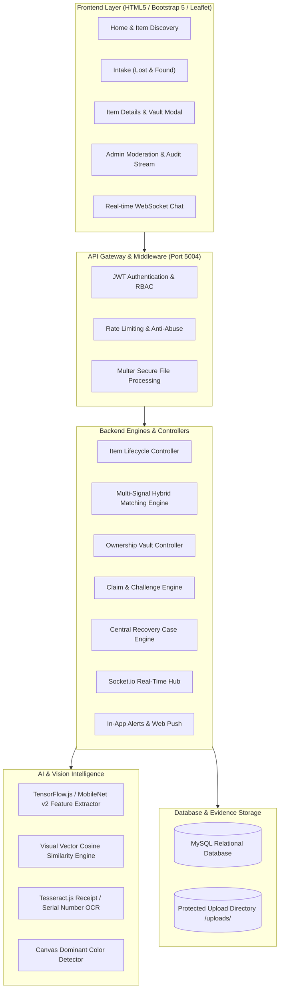

# Intelligent Object Recovery and Ownership Verification Platform
### Computer Vision, Semantic Search, Ownership Vault & Case Tracking (Without QR)

An enterprise-grade, privacy-first Lost and Found ecosystem featuring multi-signal hybrid matching, protected ownership vaults, dynamic ownership challenge verification, fraud intelligence, real-time WebSocket communications, spatial proximity analysis, and central recovery case lifecycles.

---

## 🏛️ System Architecture



---

## 🚀 Key Modules & Capabilities

### 1. Multi-Signal Hybrid Matching & Explainability
- **Visual Similarity:** MobileNet vector embedding generation and cosine similarity calculation.
- **Semantic Text Matching:** Normalized keyword and token intersection across title, brand, color, and description.
- **Geospatial Distance:** Haversine formula calculation in kilometers.
- **Temporal Proximity:** Incident date differential scoring.
- **Confidence & Uncertainty:** Tiered confidence outputs (`HIGH`, `MEDIUM`, `LOW`, `INSUFFICIENT_EVIDENCE`) paired with quantitative uncertainty metrics ($1.0 - \text{Confidence}$).
- **Explainable Reasons:** Human-readable badges explaining matching factors to moderators and users.

### 2. Protected Ownership Evidence Vault
- Strict segregation between public listing details and confidential ownership proof (serial numbers, invoice numbers, warranty receipts, hidden identifying marks).
- Resource-level authorization: Non-owners are strictly blocked (`403 Forbidden`) from viewing private vault records.

### 3. Interactive Ownership Challenge System
- Custodians / Finders can issue interactive challenge questions based on non-public item characteristics.
- Claimants must correctly answer before ownership verification is confirmed.

### 4. Automated Fraud & Risk Intelligence
- Velocity monitoring: Detects accounts submitting >3 claims in 24 hours.
- Duplicate claim detection: Flags competing claims filed on the same item.
- Real-time risk categorization (`NORMAL`, `REVIEW_REQUIRED`, `SUSPICIOUS`) logged directly to the admin moderation dashboard.

### 5. Central Recovery Case Ledger (`REC-YYYY-XXXXX`)
- Every claim generates a persistent recovery case tracking owner, finder, claimant, verification progress, and physical custody handover.
- Full immutable audit logging for all status transitions and administrative overrides.

### 6. Geolocation & Safe Handover Zones
- Interactive Leaflet.js mapping with spatial proximity search radius filtering.
- Catalog of verified 24/7 drop-off points (Police stations, transit customer service, campus security).

---

## 📡 REST API Reference

| Group | Method | Endpoint | Description | Auth |
| :--- | :--- | :--- | :--- | :--- |
| **Auth** | `POST` | `/api/auth/register` | Register new user account | Public |
| | `POST` | `/api/auth/login` | Authenticate & issue JWT token | Public |
| **Items** | `POST` | `/api/lost` | Report lost item (with image embeddings) | Optional |
| | `POST` | `/api/found` | Report found item (awards +50 Karma) | Optional |
| | `GET` | `/api/items` | Fetch all public item listings | Public |
| | `GET` | `/api/item/:id` | Fetch single item (with contact privacy masking) | Public |
| | `POST` | `/api/item/:id/verify-quiz` | Answer ownership quiz to unmask contacts | Public |
| | `DELETE` | `/api/item/:id` | Delete item report | Owner/Admin |
| **Matching** | `GET` | `/api/match/instant/:itemId` | Fetch ranked candidate matches | Public |
| | `POST` | `/api/match/hybrid-evaluate` | Pairwise multi-signal hybrid evaluation | Public |
| **Vault** | `POST` | `/api/vault/deposit` | Deposit private receipts, serial & hidden marks | Owner |
| | `GET` | `/api/vault/:itemId` | Retrieve private ownership evidence | Owner/Admin |
| **Claims** | `POST` | `/api/claims/submit` | Submit claim & spawn `REC-YYYY-XXXXX` case | User |
| | `POST` | `/api/claims/challenge` | Issue ownership challenge question | Custodian |
| | `POST` | `/api/claims/challenge/verify`| Answer ownership challenge | Claimant |
| | `POST` | `/api/claims/approve` | Approve claim & generate 6-digit OTP | Custodian |
| | `POST` | `/api/claims/verify-otp` | Verify Handover OTP & award +200 points | Custodian |
| **Cases** | `GET` | `/api/cases` | List user recovery cases | User |
| | `GET` | `/api/cases/:caseNumber` | Fetch recovery case details & audit timeline | User |
| | `PATCH` | `/api/cases/:caseNumber/status` | Update recovery case status | User/Admin |
| **Admin** | `GET` | `/api/admin/stats` | Platform analytics & recovery rate | Admin |
| | `GET` | `/api/admin/heatmap-data` | Leaflet geospatial heatmap data points | Admin |
| | `GET` | `/api/admin/audit-logs` | Immutable audit log event stream | Admin |
| | `GET` | `/api/admin/fraud-alerts` | Fraud risk intelligence flags | Admin |
| | `PUT` | `/api/admin/users/:id/ban` | Ban or unban user account | Admin |

---

## 🛠️ How to Run Locally

1. **Start the Platform:**
   Double click `run.bat` or execute:
   ```bash
   node run.js
   ```
   The portal will automatically initialize the database schema, start the server on **`http://localhost:5004`**, and open your default web browser.

2. **Run the Automated Verification Test Suite:**
   ```bash
   node backend/test_suite.js
   ```
   *Runs all 28 automated integration, security, AI, vault, and recovery lifecycle tests.*
# -Object-Recovery-and-Ownership-Verification-Platform
